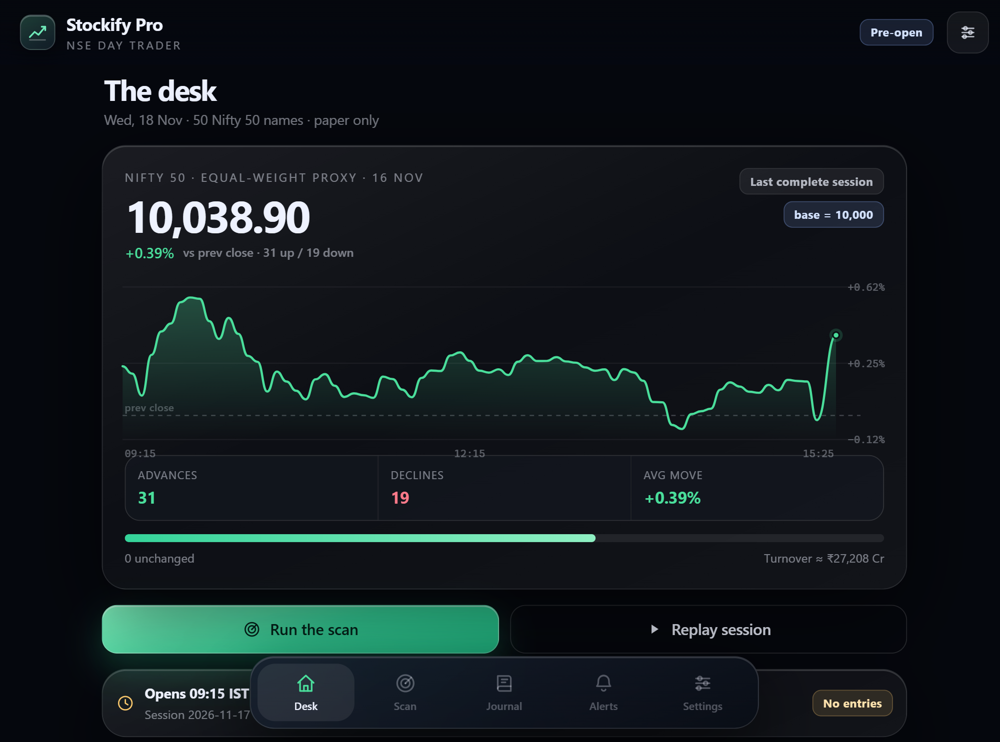
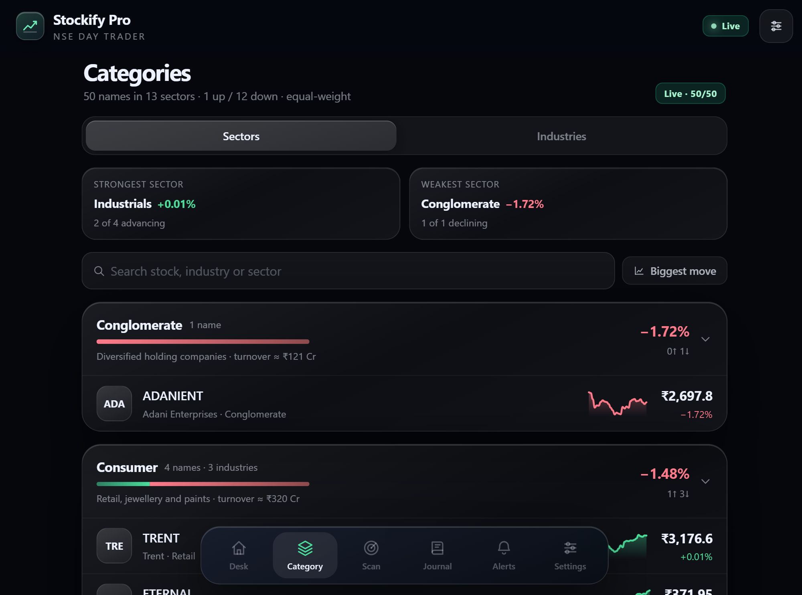
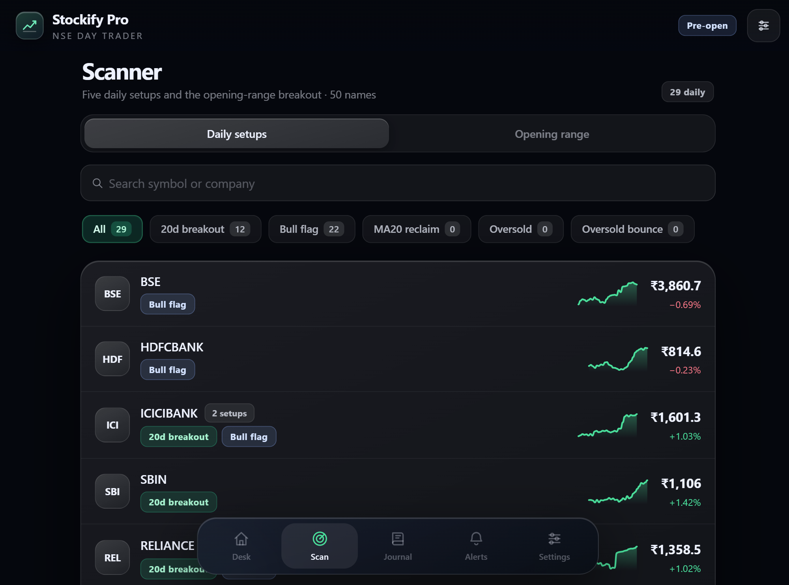
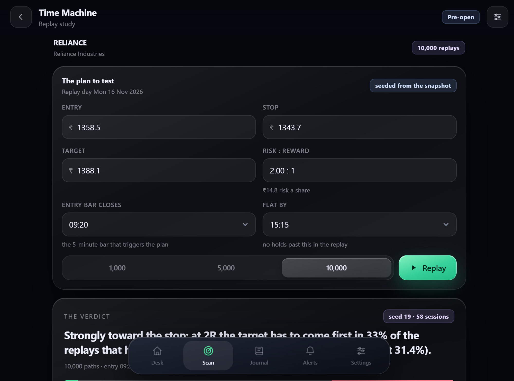

# Stockify Pro

A Nifty 50 day-trading desk for **Android, iOS and the web** — one TypeScript bundle, an
iOS-glass interface, and the complete workflow of the open-source *Day Trader* skill:
scan, time the entry, plan the exit, replay the odds, size in rupees, pass the risk gate.

Every price is real NSE data. Every order is paper.

- **Web:** https://wencateisch.github.io/stockify-pro/
- **Android:** download the APK from [Releases](../../releases/latest)
- **iOS:** open `app/ios/App/App.xcodeproj`, pick a signing team, run



## What it actually does

**1 · The desk** — an equal-weight Nifty 50 proxy charted from the real 5-minute tape, breadth
(advances / declines / average move / traded value), the market clock in IST, and a live
opening-range list. In live mode the hero switches to live quotes: the level, breadth and traded
value recompute every 30 s and the line grows one point per poll.

**2 · The categories** — all 50 names in one consistent taxonomy: 13 sectors and 28 industries,
hand-mapped so banks, NBFCs, the exchange and insurers no longer sit in a single "Financials"
pile and the retailers are together. Switch between the sector and industry views, sort by
biggest move or A–Z, search a stock, industry or sector, and read each group's equal-weight move,
breadth bar and traded value. Every name is in exactly one industry, so nothing falls through.



**3 · The scanner** — two tabs:

| Tab | What it runs |
| --- | --- |
| Daily setups | the five close-based setups: `breakout_20d`, `bull_flag`, `reclaim_ma20`, `oversold`, `oversold_bounce` |
| Opening range | 09:15–09:30 range, first *completed* 5-minute bar that closes above the range high |

Both honour a scan cutoff (09:45 / 10:30 / 12:00 / 15:30), search, setup filters, and report
which names have no complete opening range instead of guessing.



**4 · The symbol desk** — price hero, intraday chart with the opening range and your entry
drawn on it, the breakout that triggered, the five daily setups with the evidence behind them
(RSI, MA20 distance, range multiple), the plan builder (entry / stop / target), the four sizing
limits, the pre-trade risk gate, a paper order ticket, watchlist and alerts.

**5 · The Time Machine** — 10,000 replay paths through the real 5-minute history, sampled around
the same time of day as your plan's entry bar. It reports how often the target came first, how
often the stop did, and how often neither did before 15:15 — plus the median close and the
5–95% price band. It warns when the plan's entry price never traded inside the replay bar's
high/low, rather than pretending the trade happened.



**6 · Journal, alerts and settings** — paper positions marked to the snapshot / replay clock /
live feed, automatic stop and target fills, closed-trade stats in R, price alerts that fire when the
price **crosses** the armed level (checked every 2.5 s, and on the replay clock too), and editable
rules (capital, per-trade and daily loss limits, position cap, order cap, trade count, entry window,
flat-by time, blocked tickers).

## The rules, adapted from the Day Trader skill

| Rule | Default |
| --- | --- |
| Session | 09:15–15:30 IST, 75 five-minute slots |
| Entries | 09:45 → 15:00 only |
| Flat by | 15:15 |
| Stop | required (default: opening-range mid, rounded down to ₹0.05) |
| Target | entry + R × risk, minimum R:R 1.0 |
| Size | min(max-loss ÷ risk, 50% of capital, ₹1,00,000 order); whole shares |
| Cash | 10% buffer held back |
| Daily stops | ₹6,000 realised loss, 3 entries, 10 orders |
| Tick | ₹0.05 |

Any breach blocks the order and says why. There is no "override" button.

## Data honesty

- The app boots on a **bundled snapshot**: 50 Nifty 50 symbols, 90 daily bars and 59 complete
  five-minute sessions each, fetched from Yahoo Finance's public NSE chart endpoint on
  17 Nov 2026, 13:31 IST. Regenerate it with `node scripts/fetch-market-data.mjs`.
- The intraday tab always charts the **last complete session** in the snapshot and says which
  date that is. Where Yahoo dropped a 5-minute print, the scanner reports the missing bars and
  uses the prints that exist — it never interpolates one.
- **Live mode** needs no server: the app reads Moneycontrol's public NSE price feed directly in
  the browser every 30 seconds. All 50 scrip ids are pinned in `app/src/lib/mc.ts`, and each one
  was verified against the feed's `NSEID` field so a bad key cannot show another company's quote.
  The feed sends `Access-Control-Allow-Origin: *`, so it also works on the static GitHub Pages build.
- **Your own server** is still supported (`backend/`), and is the only option if you want to add a
  provider of your choice. Point Settings → Live source at "My server" and set its URL.
- Prices are exchange-delayed, and the equal-weight proxy is **not** the NIFTY 50 index. The desk
  hero switches to a live equal-weight proxy (breadth, turnover and a line that extends one point
  per poll) as soon as live quotes arrive; the historical tape is only used when live is off.
- Nothing here connects to a broker. Fills, positions and P&L are paper and stay in
  `localStorage` on the device.

## Run it locally

```bash
cd app
npm install
npm run dev          # http://localhost:5173
npm run typecheck
npm run build
```

Native shells (already generated in `app/android` and `app/ios`):

```bash
cd app
npx cap sync android        # after a build
npx cap open android        # Android Studio
npx cap sync ios
npx cap open ios            # Xcode (macOS)
```

Local Android build:

```bash
cd app/android
./gradlew assembleDebug     # app/build/outputs/apk/debug/app-debug.apk
```

Icons and splash screens come from `scripts/make-icons.ps1` (Windows PowerShell / GDI+).

### Live feed

Live mode works with **no backend at all**: Settings → Live feed → "Direct NSE feed" polls
Moneycontrol's public NSE endpoint every 30 seconds from the browser. If you would rather run your
own proxy (or add a provider), the bundled backend proxies Yahoo Finance instead:

```bash
cd backend
npm install
npm start                   # http://localhost:3001
```

| Endpoint | Returns |
| --- | --- |
| `GET /health` | liveness, symbols, last refresh |
| `GET /api/quotes` | all 50 quotes (`?symbols=TCS,INFY` to filter) |
| `GET /api/quotes/:symbol` | one quote |
| `GET /api/chart/:symbol?range=5d&interval=15m` | Yahoo chart passthrough |
| `GET /api/news?limit=12` | Nifty headlines from Yahoo's RSS feed |
| Socket.IO `quotes` | the same array, pushed every refresh |

Then set **Settings → Live source → My server** (use your LAN IP for a phone, e.g.
`http://192.168.1.20:3001`).

`Dockerfile` builds the web bundle and the proxy into one image (`PORT=3001`).

## Repository layout

```
app/            React + TypeScript + Vite frontend (the app)
  src/lib/      data, indicators, sector map, plan/sizing/risk, ORB, Time Machine engine, store
  src/screens/  Desk, Category, Scanner, Symbol, TimeMachine, Journal, Alerts, Settings
  android/      Capacitor Android project (icons, splash, dark theme)
  ios/          Capacitor iOS project
  public/data/  bundled market.json + 50 history files
backend/        Yahoo Finance proxy (REST + Socket.IO)
scripts/        fetch-market-data.mjs, make-icons.ps1
.github/        Pages deploy + Android APK workflows
```

The Time Machine engine runs in a Web Worker, so 10,000 paths never block the UI.

## Credits

The trading rules are a TypeScript port of the open-source **Day Trader** skill
(Nifty 50 scanner, opening-range breakout, exit planner, Monte-Carlo replay, sizing and risk
gates). This project is an independent graphical product built on those rules.

## Disclaimer

Education and tooling, not investment advice. Paper only. Market data is delayed and provided
by an unofficial Yahoo Finance endpoint; verify anything before risking real money.

MIT licensed.
